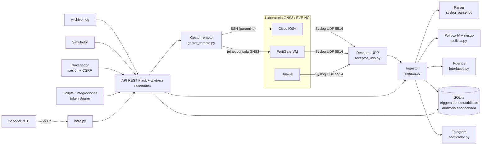
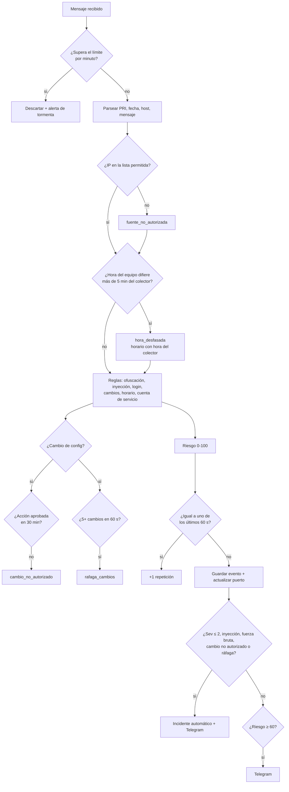
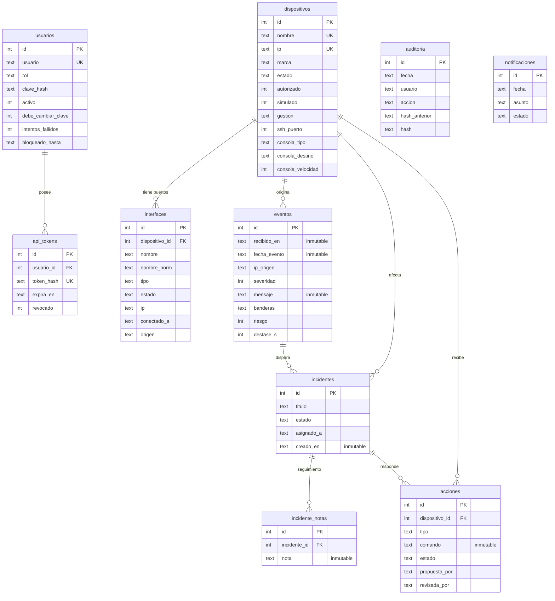

# Arquitectura y modelo de datos (v1.0.0)

## Diagrama de arquitectura

## Flujo de un mensaje Syslog

## Modelo de datos

## Módulos

| Módulo | Responsabilidad |
|--------|-----------------|
| `app.py` | Crea la app, cabeceras de seguridad; arranca receptor, Telegram, NTP y waitress |
| `config.py` | Configuración desde `.env` |
| `noc/db.py` | Conexión, migración, semilla con puertos, auditoría encadenada |
| `noc/schema.sql` / `schema_triggers.sql` | Tablas / 11 reglas de inmutabilidad |
| `noc/autenticacion.py` | Claves, bloqueo, clave temporal, tokens |
| `noc/syslog_parser.py` | RFC 5424/3164, Cisco, Fortinet, Huawei |
| `noc/politica.py` | Reglas, ofuscación, riesgo, deduplicación, tormentas |
| `noc/ingesta.py` | Canal único: hora, política, correlación, puertos, incidentes y alertas |
| `noc/interfaces.py` | Normalización y lectura de puertos |
| `noc/gestor_remoto.py` | SSH y consola telnet con listas permitidas |
| `noc/notificador.py` | Telegram |
| `noc/hora.py` | Cliente SNTP |
| `noc/simulador.py` | Escenarios normal, ataque IA (8 técnicas) y tormenta |
| `noc/generador_config.py` | Configuraciones comentadas por fabricante |
| `noc/consola.py` | Lista de comandos permitidos y bloqueados; salidas simuladas |
| `noc/catalogo_acciones.py` | Acciones de respuesta permitidas |
| `noc/routes/*` | API REST: usuarios, dispositivos, eventos, incidentes, acciones, herramientas |
| `static/js/*` | Acceso, panel, eventos, incidentes, aprobaciones, inventario, herramientas, administración |
| `tools/*` | Respaldo, restauración, carga, crear usuario, equipo virtual y envío UDP |

## Severidades Syslog (RFC 5424)

| Código | Nombre | Uso en el NOC |
|--------|--------|---------------|
| 0 | Emergency | Incidente automático + Telegram |
| 1 | Alert | Incidente automático + Telegram |
| 2 | Critical | Incidente automático + Telegram |
| 3 | Error | Cuenta como «crítico» en el panel |
| 4 | Warning | Advertencia |
| 5 | Notice | Normal pero significativo |
| 6 | Informational | Informativo |
| 7 | Debug | Depuración |
