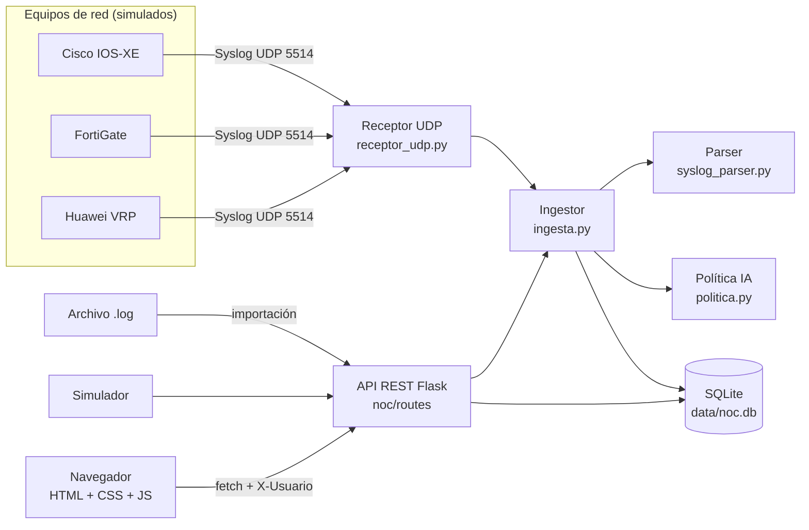
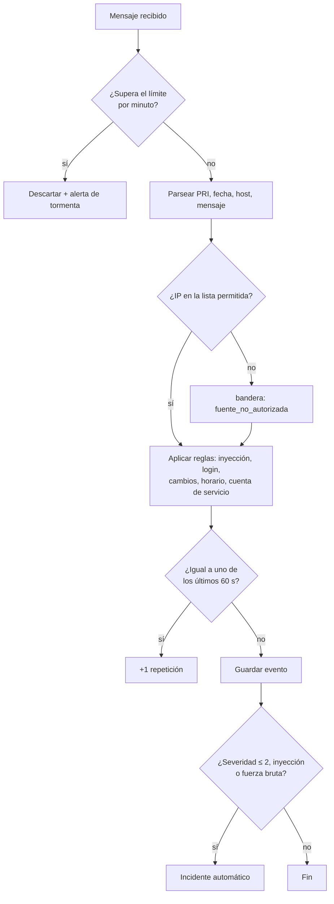
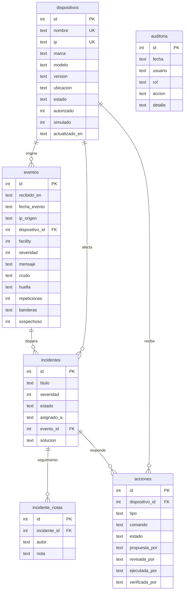

# Arquitectura y modelo de datos (v0.2.0)

## Diagrama de arquitectura

## Flujo de un mensaje Syslog

## Modelo de datos

## Módulos

| Módulo | Responsabilidad |
|--------|-----------------|
| `app.py` | Crea la aplicación, cabeceras de seguridad y arranca el receptor |
| `config.py` | Lee la configuración desde `.env` |
| `noc/db.py` | Conexión SQLite, esquema, datos semilla y auditoría |
| `noc/syslog_parser.py` | RFC 5424, RFC 3164, Cisco, Fortinet y Huawei |
| `noc/politica.py` | Reglas de detección, deduplicación y control de tormentas |
| `noc/ingesta.py` | Canal único de procesamiento de mensajes |
| `noc/receptor_udp.py` | Hilo que escucha UDP |
| `noc/simulador.py` | Escenarios normal, ataque IA y tormenta |
| `noc/generador_config.py` | Configuraciones comentadas por fabricante |
| `noc/consola.py` | Listas de comandos permitidos y bloqueados |
| `noc/catalogo_acciones.py` | Catálogo cerrado de acciones de respuesta |
| `noc/routes/*` | API REST por módulo |
| `static/js/*` | Una vista por archivo |

## Severidades Syslog (RFC 5424)

| Código | Nombre | Uso en el NOC |
|--------|--------|---------------|
| 0 | Emergency | Sistema inutilizable → incidente automático |
| 1 | Alert | Acción inmediata → incidente automático |
| 2 | Critical | Condición crítica → incidente automático |
| 3 | Error | Cuenta como «crítico» en el panel |
| 4 | Warning | Advertencia |
| 5 | Notice | Normal pero significativo |
| 6 | Informational | Informativo |
| 7 | Debug | Depuración |
